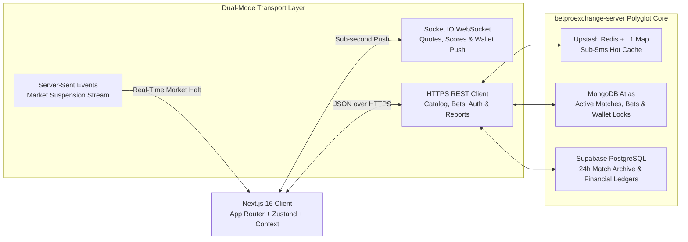
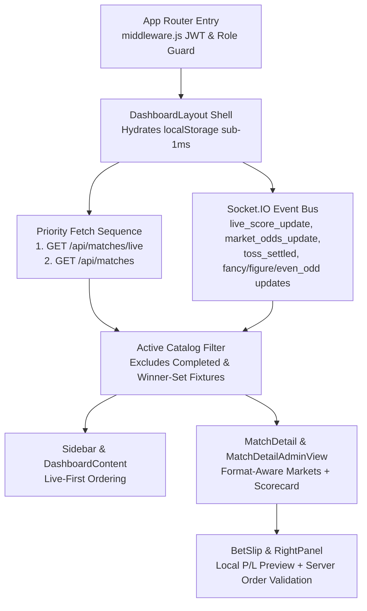

<div align="center">

# BetPro Exchange — Next.js Frontend Client

**Real-Time Cricket Betting Exchange & Multi-Tier Hierarchy Dashboard**

[](https://nextjs.org/)
[](https://react.dev/)
[](https://tailwindcss.com/)
[](https://socket.io/)
[](https://github.com/pmndrs/zustand)
[](https://tanstack.com/query)
[](https://pixijs.com/)
[]()

</div>

---

## Overview

**BetPro Exchange Frontend** is the high-frequency client web application for a real-time cricket betting exchange platform built with **Next.js 16 (App Router + Turbopack)**, **React 19**, and **Tailwind CSS v4**. It connects over dual-transport WebSocket/REST streams to `betproexchange-server` to deliver live Back/Lay order depth, format-aware cricket markets, chronological ball-by-ball (`This Over`) telemetry, live video streaming, and five role-isolated management consoles (**User**, **Master**, **Super Master**, **Admin**, **Super Admin**).

---

## Technology Stack

<p align="left">
  
</p>

| Layer | Technology | Version | Architectural Role |
|---|---|---|---|
| **Meta-Framework** | Next.js (App Router + Turbopack) | `16.2.3` | 37 static & dynamic routes, `compress: true`, `poweredByHeader: false` |
| **UI Runtime** | React & React DOM | `19.2.4` | Concurrent rendering, optimistic bet-slip previews, rate-flash diffs |
| **Styling Engine** | Tailwind CSS + PostCSS | `v4` | Responsive exchange grid, desktop/mobile sticky bet slips, zero-runtime utility CSS |
| **Streaming & Sockets** | Socket.IO Client + SSE | `4.8.3` | Bi-directional live odds/score push with polling & REST serverless fallback |
| **State & Server Cache** | Zustand + React Context + TanStack Query | `5.0.14` / `5.101.2` | Active fixture hydration, UI market filters, wallet sync & query caching |
| **Animations & 2D Canvas** | Framer Motion + PixiJS | `12.42.2` / `8.19.0` | Micro-interactions, modal transitions & WebGL canvas games |
| **Iconography & Cloud SDK** | Lucide React + Firebase SDK | `1.8.0` / `12.12.0` | Sharp vector UI icons & auxiliary realtime integration |
| **Code Quality** | ESLint + `eslint-config-next` | `9.x` / `16.2.3` | Static lint rules across Next.js App Router components |

---

## System Design & Architecture

### 1. High-Level Client-Server Topology



### 2. Multi-Layer Client Architecture



### 3. Transport Strategy (`lib/apiConfig.js`)

| Deployment Target | Primary Real-Time Channel | Fallback / Sync Strategy |
|---|---|---|
| **Dedicated Node Backend (Render / Local)** | Persistent Socket.IO (`polling` -> `websocket` upgrade) + SSE | Periodic 3s `/live` & 30s catalog reconciliation |
| **Serverless Backend (Vercel)** | Safe mock socket wrapper (`createMockSocket`) avoiding stateless WS 400 drops | Deterministic REST polling intervals (3s live scores, 4s wallet sync) |

### 4. Client Data Consistency & Performance Decisions

- **Two-Stage Instant Dashboard Hydration**: Restores cached active matches from `localStorage` immediately after mount (zero SSR hydration mismatch), prioritizes `/api/matches/live` first so live matches paint before the full catalog finishes, and runs background catalog refreshes cleanly.
- **Strict Active-Feed Filtering**: Client listeners (`matches_updated`, `live_score_update`, `match_result`) strip finished or winner-declared fixtures out of active navigation lists while preserving direct scorecard lookup links via `/dashboard?match=<id>` inside the 24-hour archive window.
- **Format-Specific Market Isolation (`lib/matchFormat.js`)**: Shared classifier guarantees only **Test / First-Class** fixtures display **The Draw** in Match Odds, Bookmaker, and the dashboard `X` column; **T10 / T20 / ODI** matches hide `The Draw` completely and place **TIED MATCH (`Yes` / `No`)** in the market footer.

---

## Core Features

- **Exchange Markets (`MatchDetail.jsx` & `MatchDetailAdminView.jsx`)**
  - **Match Odds & Bookmaker**: Multi-level Back/Lay price-volume ladders with flash indicators and runner net book profit/loss overlays.
  - **Toss Market (`lib/tossFormat.js`)**: Standardized `1.98` Back / `2.02` Lay pre-match market; shows a green toss winner banner in the match header until play starts and auto-hides the Toss market panel 20 minutes after declaration.
  - **Fancy, Fancy-2, Figure & Even-Odd**: Over-by-over session runs, last-digit (`0–9`) figure grids, and run parity with live `MARKET SUSPENDED` overlay locking driven by backend suspension streams.
  - **Tied Match (Footer)**: Dedicated `Yes` / `No` tie market rendered cleanly in the footer for T10, T20, and ODI fixtures.

- **Live Cricket Scorecard**
  - Chronological **This Over** ball pills (`W` / `Wd+W` / `Nb+W`, boundaries `4` / `6`, `Wd` / `Nb` extras, `Lb` / `B` byes), active striker/non-striker & bowler figures, CRR, RRR, target chase counter, and feed staleness indicator.

- **5-Tier Hierarchy Governance Consoles**
  - Role-specific portals for `/dashboard` (Player), `/master`, `/supermaster`, `/admin`, and `/superadmin` featuring downline account provisioning, cash/credit settlements, max-bet & profit-limit tables, live current-position exposure books, Daily Report, Final Sheet, and Account Ledger statements.

---

## Directory Structure

```text
betproexchange/
├── app/                              # Next.js App Router (37 routes across 5 RBAC tiers)
│   ├── layout.js                     # Root shell & typography setup
│   ├── page.jsx                      # Entry redirect controller
│   ├── login/                        # Role-aware login screen
│   ├── accounts/ledger/              # Cross-tier account ledger route
│   ├── dashboard/                    # Player exchange, bets, statement, profit-loss & results
│   ├── master/                       # Master hierarchy portal & exposure views
│   ├── supermaster/                  # Super Master hierarchy portal & exposure views
│   ├── admin/                        # Admin match controls, betlock & reports
│   └── superadmin/                   # Root SuperAdmin governance console
├── components/                       # Modular React components
│   ├── DashboardLayout.jsx           # Socket.IO/REST engine & context store
│   ├── DashboardContent.jsx          # Sport filter tabs & active fixture grid
│   ├── Sidebar.jsx                   # Live-first collapsible navigation rail
│   ├── Header.jsx                    # Balance, exposure, cash/credit header
│   ├── MatchDetail.jsx               # User betting & scorecard workspace
│   ├── MatchDetailAdminView.jsx      # Hierarchy/admin control & winner panel
│   ├── BetSlip.jsx                   # Back/Lay stake calculator & quick chips
│   ├── RightPanel.jsx                # Live TV view & open/matched bet tables
│   ├── AccountLedger.jsx             # Period financial ledger viewer
│   ├── FinalSheet.jsx                # P/L hierarchy settlement sheet
│   ├── CurrentPositionView.jsx       # Live hierarchy exposure book
│   ├── admin/ | master/ | supermaster/ | superadmin/
│   └── casino/ | teenpatti/
├── lib/                              # Shared client libraries
│   ├── apiConfig.js                  # Dynamic backend URL & serverless detector
│   ├── auth.js                       # Client token storage & role guards
│   ├── betCalc.js                    # Exchange book, commission & P/L math
│   ├── matchFormat.js                # Test vs T10/T20/ODI classifier
│   ├── tossFormat.js                 # Match-header toss banner formatter
│   ├── suspension/                   # Client suspension state evaluators
│   └── useTeenPattiStore.js          # Zustand store
├── middleware.js                     # Edge RBAC route protection
├── next.config.mjs                   # Turbopack, compression & caching config
└── package.json                      # Dependencies & scripts
```

---

## Getting Started

### Prerequisites

- **Node.js** `>= 20.x`
- **npm** `>= 10.x`
- Running instance of `betproexchange-server`

### Environment Variables

Create a `.env.local` file in the root directory (see `.env.example`):

```env
NEXT_PUBLIC_API_URL=http://localhost:5000
```

> **Security Guideline:** Only expose public client URLs via `NEXT_PUBLIC_*`. Database URIs, Redis tokens, Supabase secret keys, JWT signing keys, and third-party sports API credentials must remain strictly server-side.

### Commands

```bash
# Install dependencies
npm install

# Run local development server (http://localhost:3000)
npm run dev

# Build production bundle (verifies all 37 routes)
npm run build

# Start production Next.js server
npm start

# Run ESLint checks
npm run lint
```

---

## License

Proprietary and Confidential. Unauthorized copying, distribution, or modification via any medium is strictly prohibited.
