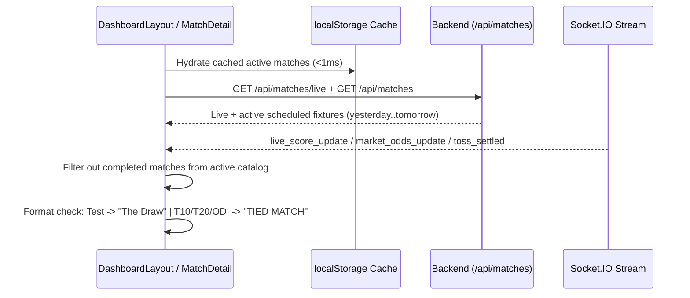

<div align="center">

# BetPro Exchange — Next.js Frontend Client

**Real-Time Cricket Betting Exchange & Multi-Tier Hierarchy Dashboard**

[](https://nextjs.org/)
[](https://react.dev/)
[](https://tailwindcss.com/)
[](https://socket.io/)
[](https://github.com/pmndrs/zustand)
[](https://tanstack.com/query)
[]()

</div>

---

## Overview

**BetPro Exchange Frontend** is the high-throughput web client for a real-time cricket betting exchange platform built with **Next.js 16 (App Router + Turbopack)**, **React 19**, and **Tailwind CSS v4**. Designed for sub-second market responsiveness, it connects to the `betproexchange-server` WebSocket and REST transport layer to render live Back/Lay order books, format-aware cricket markets, chronological ball-by-ball (`This Over`) scorecards, and five role-isolated management portals (**User**, **Master**, **Super Master**, **Admin**, **Super Admin**).

---

## Tech Stack

<p align="left">
  
</p>

| Layer | Technology | Purpose |
|---|---|---|
| **Framework** | Next.js `16.2.3` (App Router, Turbopack) | SSR/Static routing (`37` routes), `compress: true`, `poweredByHeader: false` |
| **UI Library** | React `19.2.4` | Interactive match detail, real-time odds flashing & exposure books |
| **Styling** | Tailwind CSS `v4` (`@tailwindcss/postcss`) | Utility-first responsive desktop/mobile exchange layout |
| **Real-Time Transport** | Socket.IO Client `4.8.3` + REST Fallback | Streaming quotes/scores with deterministic polling fallback on serverless hosts |
| **State & Data** | React Context + Zustand `5.0.14` + TanStack Query `5.101.2` | Instant match hydration, order-slip state, and cache invalidation |
| **Motion & Graphics** | Framer Motion `12.42.2`, Lucide React `1.8.0`, PixiJS `8.19.0` | Animations, iconography, and interactive game canvases |
| **Edge Optimization** | Next/Image (`AVIF`/`WebP`), `optimizePackageImports` | Low-latency asset delivery and stripped console logs in production |

---

## System Design Architecture

### High-Level Client-Server Topology

```mermaid
flowchart LR
    Browser["Next.js 16 Client\n(App Router + Zustand + Socket.IO)"]

    subgraph Transport["Real-Time & API Layer"]
        WS["Socket.IO WebSocket / Polling\n(Quotes, Scores, Settlements)"]
        SSE["Server-Sent Events (SSE)\n(/suspension-stream)"]
        REST["Express REST API\n(Catalog, Auth, Orders, Reports)"]
    end

    subgraph Backend["betproexchange-server Polyglot Core"]
        Redis["Upstash Redis + L1 Map\nSub-5ms Hot Cache"]
        Mongo["MongoDB Atlas\nOperational State & Locks"]
        Supa["Supabase PostgreSQL\nArchives, Ledgers & Audits"]
    end

    Browser <-->|"Sub-second push"| WS
    Browser <--|"Market halt stream"| SSE
    Browser <-->|"HTTPS JSON (Bearer JWT)"| REST
    REST <--> Redis
    REST <--> Mongo
    REST <--> Supa
```

### Client Match & Market State Flow



---

## Core Capabilities

- **Exchange Betting Markets**
  - **Match Odds & Bookmaker**: Live Back (blue) & Lay (pink) depth ladders with rate-change flash highlighting and unmatched/matched open bet tracking.
  - **Format-Aware Market Rules (`lib/matchFormat.js`)**: Automatically classifies fixtures—**Test / First-Class** matches render **The Draw** in Match Odds and Bookmaker, whereas **T10 / T20 / ODI** fixtures suppress `The Draw` and display **TIED MATCH (`Yes` / `No`)** in the footer (`Others`).
  - **Toss Market Lifecycle (`lib/tossFormat.js`)**: Standardized `1.98` Back / `2.02` Lay pre-match toss market; displays settled toss winner banner in the match header until the match begins, auto-hides the Toss section 20 minutes after declaration, and closes cleanly at match start.
  - **Session & Micro Markets**: **Fancy / Fancy-2** over-line markets, **Figure** (`0–9` last-digit grid), and **Even / Odd** run parity with real-time suspension overlays.

- **Live Scorecard & Chronological Ball Tracking**
  - Chronological **This Over** delivery strip with color-coded pills (`W` / `Wd+W` / `Nb+W` wickets, `4` / `6` boundaries, `Wd` / `Nb` wides/no-balls, `Lb` / `B` byes), active striker/non-striker & bowler figures, CRR, RRR, target, and staleness warning indicator.

- **Active Dashboard Catalog Hygiene**
  - Displays actively live matches first followed by active upcoming matches, filtering completed/resulted fixtures out of the main dashboard and sidebar lists so only actionable betting markets appear.

- **Role-Based Governance Portals**
  - Dedicated App Router dashboards and ledgers across `/dashboard`, `/master`, `/supermaster`, `/admin`, and `/superadmin`:
    - Real-time runner net P/L book indicators per hierarchy tier.
    - User provisioning, credit/cash settlement, profit & bet-size limit configuration, Final Sheet, Daily Report, and Account Ledger views.
    - SuperAdmin fixed header wallet display (`100,000`) backed by server-enforced unlimited root distribution.

---

## Directory Structure

```text
betproexchange/
├── app/                              # Next.js App Router (37 static/dynamic routes)
│   ├── layout.js                     # Root HTML shell, typography & global styles
│   ├── page.jsx                      # Entry redirect handler
│   ├── login/                        # Role-aware authentication screen
│   ├── accounts/ledger/              # Shared account ledger view
│   ├── dashboard/                    # Player portal (bets, statement, profit-loss, result)
│   ├── master/                       # Master hierarchy portal & books
│   ├── supermaster/                  # Super Master hierarchy portal & books
│   ├── admin/                        # Admin match management, betlock & reports
│   └── superadmin/                   # Root SuperAdmin governance console
├── components/                       # Modular React components
│   ├── DashboardLayout.jsx           # Global Socket.IO/REST sync & context provider
│   ├── DashboardContent.jsx          # Sport category tabs & active match board
│   ├── Sidebar.jsx                   # Live-first collapsible sidebar navigation
│   ├── Header.jsx                    # Balance, exposure & user menu bar
│   ├── MatchDetail.jsx               # Player exchange view (odds, toss, fancy, scorecard)
│   ├── MatchDetailAdminView.jsx      # Hierarchy/admin control & winner declaration view
│   ├── BetSlip.jsx                   # Back/Lay stake calculator & order submission
│   ├── RightPanel.jsx                # Live TV stream & open/matched bet tables
│   ├── AccountLedger.jsx             # Cross-period financial statement view
│   ├── FinalSheet.jsx                # Hierarchy profit/loss settlement sheet
│   ├── admin/ | master/ | supermaster/ | superadmin/
│   └── casino/ | teenpatti/          # Interactive game modules (development stage)
├── lib/                              # Shared client libraries
│   ├── apiConfig.js                  # Environment-aware backend URL & transport selector
│   ├── auth.js                       # Session storage & JWT role helpers
│   ├── betCalc.js                    # Exchange book, commission & P/L math utilities
│   ├── matchFormat.js                # Cricket format classifier (Test vs T10/T20/ODI)
│   ├── tossFormat.js                 # Toss header decision text formatter
│   ├── suspension/                   # Client-side suspension state evaluators
│   └── useTeenPattiStore.js          # Zustand state store
├── middleware.js                     # Route protection & role path enforcement
├── next.config.mjs                   # Turbopack, compression & image/header rules
└── package.json                      # Dependencies & scripts
```

---

## Getting Started

### Prerequisites

- **Node.js** `>= 20.x`
- **npm** `>= 10.x`
- Running instance of `betproexchange-server`

### Environment Configuration

Create a `.env.local` file in the project root (see `.env.example`):

```env
NEXT_PUBLIC_API_URL=http://localhost:5000
```

> **Security Note:** Never place backend database URIs, Supabase service secrets, JWT secrets, or external feed API keys in client-side `NEXT_PUBLIC_*` variables.

### Installation & Local Development

```bash
# Install dependencies
npm install

# Start development server (http://localhost:3000)
npm run dev

# Build optimized production bundle
npm run build

# Start production server
npm start
```

---

## Security Practices

- **Zero Secrets in Client Bundle**: Only `NEXT_PUBLIC_API_URL` is exposed to browser code; all external cricket API keys and database credentials reside exclusively on `betproexchange-server`.
- **Hardened HTTP Configuration**: `poweredByHeader: false` hides framework fingerprints, paired with strict route-level authentication checks in `middleware.js` and `DashboardLayout.jsx`.
- **Server-Validated Order Books**: Client-side bet slips preview profit and liability locally, while all odds, market suspensions, profit caps, and wallet balances are strictly re-verified server-side before acceptance.

---

## License

Proprietary and Confidential. Unauthorized copying, distribution, or modification without explicit written authorization is strictly prohibited.
